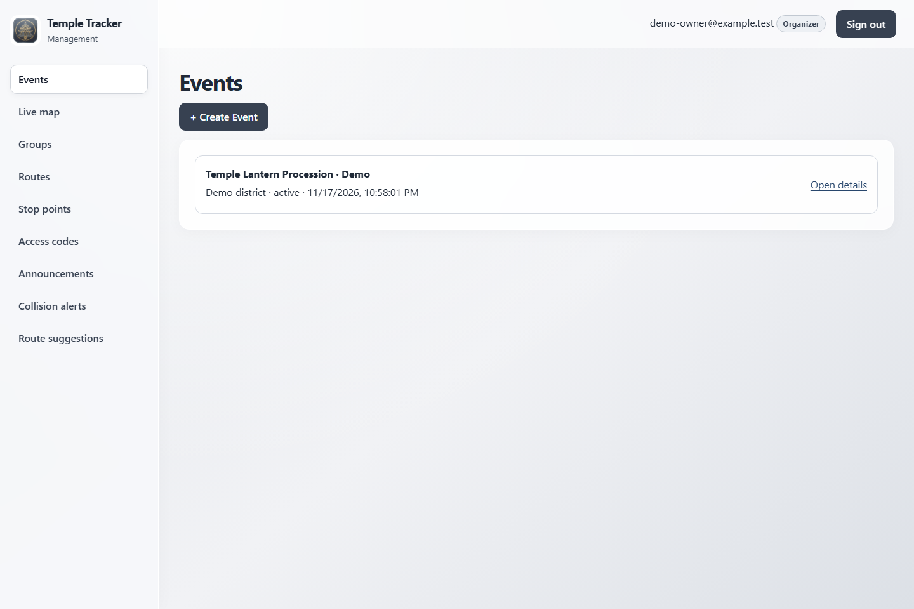
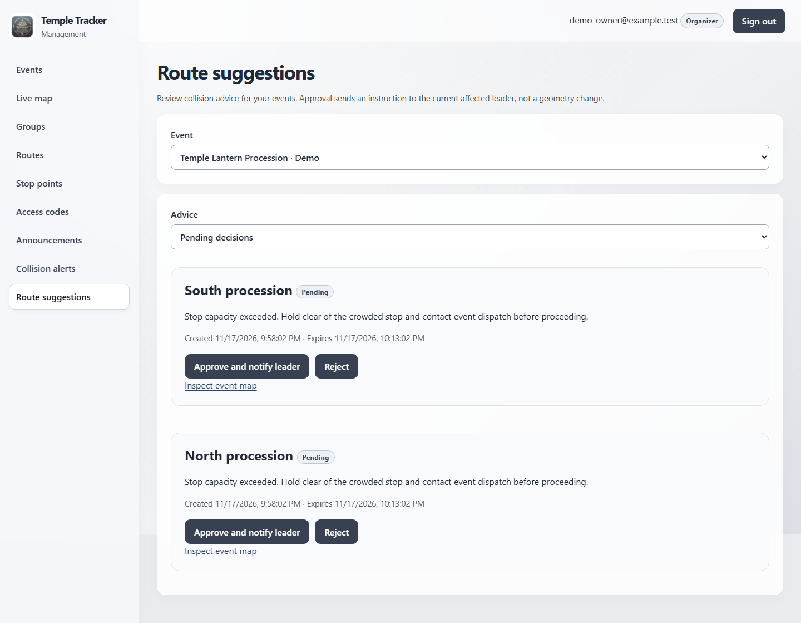

# Temple Procession Tracker

Android procession tracking, an organizer/admin web dashboard, and a trusted Firebase backend. The pre-merge upgrade was locally implemented and tested; incoming additions have not yet been revalidated together. This is **not a deployed or field-certified release**. See the latest [bug repair and deployment report](docs/BUG_FIX_REPORT.md), the earlier [upgrade status](docs/UPGRADE_STATUS.md), and [operations/runbook](docs/OPERATIONS.md).

## Project layout

- [Flutter Android app](mobile_app/temple_procession_tracker_app/): role-aware events, organizer editing, maps, membership, leader tracking, announcements and notifications.
- [React dashboard](admin_dashboard/): event planning, route drawing, stops/groups, live/history maps, codes, suggestions and admin-only accounts.
- [Cloud Functions](functions/src/): authorization, validated management, membership transactions, tracking processing, retryable notifications and scheduled maintenance.
- [Security rules and indexes](firebase_rules/), [verification/branding scripts](scripts/), and [original supplied icon](assets/branding/temple-icon.png).

The stack is Flutter/Dart with Google Maps and Geolocator, React 19/TypeScript/Vite 8, and Firebase Authentication, Firestore, Realtime Database, Cloud Functions v2 (Node.js 24), Cloud Messaging and Storage. The source repository is [Walter926/temple-procession-tracker](https://github.com/Walter926/temple-procession-tracker).

## Feature and phase status

Role-aware authentication, event/route/stop/group management, trusted access-code redemption, assigned-primary foreground tracking, authorized maps, server-derived arrivals/progress/approximate ETA, collision advice and scoped notifications are covered by the pre-merge implementation reports. Code presence and local tests do not establish deployed availability.

The Phase 37–41 labels below follow the incoming MVP roadmap; the later upgrade inventory uses a separate numbering scheme. Its older Phase 31-only status does not supersede the more recent reports.

| Incoming phase | Current evidence and remaining gate |
| --- | --- |
| 37 — Notifications | Pre-merge implementation includes scoped in-app records, instruction acknowledgements and retryable push delivery. Real FCM receipt and device permission/background behavior still require acceptance testing. |
| 38 — Location history | The existing exported [progress handler](functions/src/route_progress.ts) records trusted history at most once per 15 seconds; the live-map page includes recorded paths. Incoming standalone history code is not an enabled replacement for that path. |
| 39 — MVP regression | Local regression and browser results are recorded in the bug repair report. They predate this merge; rerun the relevant checks after all conflicts are resolved. |
| 40 — Android field testing | The 2–4-phone GPS, crowding, network, stale-location and battery acceptance suite remains a release gate. Emulator checks or a single-device debug installation do not complete it. |
| 41 — Documentation and release | Setup/runbook documentation and actual local dashboard screenshots exist. A signed release, Git tag/GitHub MVP release and real end-to-end phone demo video remain gated on acceptance. |

In the current [dashboard routing](admin_dashboard/src/App.tsx), the incoming [Location History](admin_dashboard/src/pages/LocationHistoryPage.tsx), [Notifications](admin_dashboard/src/pages/NotificationsPage.tsx) and [Settings](admin_dashboard/src/pages/SettingsPage.tsx) components are not wired as pages; `/settings` redirects to `/events`. The incoming [history module](functions/src/location_history.ts) defines a separate 30-second-bucket writer, but it is not exported by the [Functions entry point](functions/src/index.ts). These source additions have not been validated as integrated features and must not be advertised as enabled routes or deployed handlers.

## Setup

Validated with Node 24.22.1, Java 21, Flutter 3.44.2 or 3.44.9/Dart 3.12.2, Android platform 36 and the repository's Gradle/AGP versions. Use the lockfiles. Newer Flutter versions may require a separate Gradle/plugin migration; do not upgrade only one part of that toolchain.

Install Git, Firebase CLI and Android Studio/SDK for local development. Use a Google Play-enabled Android emulator for relevant device checks; it does not replace physical-phone acceptance.

Select Flutter **3.44.2 or 3.44.9** explicitly: both use Dart 3.12.2 and pass the verification guard with the existing lockfile. Flutter 3.50 requires newer Gradle and a Material migration and is not the configured Android toolchain. Do not bypass build-dependency validation. The verification script accepts `-FlutterCommand 'C:/path/to/flutter/bin/flutter.bat'`; `-NoPub` is available when dependencies are already resolved (including Windows hosts without desktop-plugin symlink support).

```powershell
cd functions
npm ci
cd ../admin_dashboard
npm ci
cd ../mobile_app/temple_procession_tracker_app
flutter doctor -v
flutter pub get
```

On Windows, Flutter's desktop plugin symlink step can require Developer Mode. This is an OS configuration choice; it was not enabled automatically during this upgrade. Android verification succeeded with resolved packages and `--no-pub`.

1. Check [.firebaserc](.firebaserc), Android Firebase configuration and [Flutter Firebase options](mobile_app/temple_procession_tracker_app/lib/firebase_options.dart). Current target: `temple-procession-walter`, Functions region: `us-central1`.
2. Copy the dashboard [.env.example](admin_dashboard/.env.example) to a local environment file and supply your Firebase web configuration and restricted browser Maps key. Never put service-account credentials in browser variables.
3. Set `RTDB_URL` in the Functions project environment, using [the example](functions/.env.example), and set the dashboard's `VITE_FIREBASE_DATABASE_URL` to the same database URL. All three clients must use the same database/project; verify the URL in Firebase Console.
4. Create Android local `secrets.properties` containing `MAPS_API_KEY=...`. Restrict this key to package `com.walter.templeprocessiontracker` and the correct certificate fingerprints; use a separate HTTP-referrer-restricted browser key.
5. For a signed release, supply Android local `key.properties` with `storeFile`, `storePassword`, `keyAlias`, and `keyPassword`. Release tasks intentionally fail without these values; no debug-signed release fallback exists.
6. Bootstrap the first admin through a trusted Firebase Admin operation. Self-registration permits only organizer, team leader or team member. Do not change client rules to create an admin.

These local environment, Maps and signing files are ignored by Git. Public Firebase client identifiers are not privileged credentials. Enforce security through rules, API restrictions and App Check, not hidden web configuration.

Enable Maps SDK for Android and Maps JavaScript API in the intended Google Cloud project, and verify billing/API availability. Set `VITE_GOOGLE_MAPS_BROWSER_KEY` for the dashboard and restrict it to approved HTTP referrers (including the local development origin if needed). Android uses the existing Gradle/manifest `MAPS_API_KEY` substitution, not a hard-coded browser key. A successful build does not prove Maps key authorization or tile rendering.

Android 13+ notification presentation requires notification permission; leader tracking also requires foreground location permission. Simulated emulator routes are useful for local checks, but do not establish real GPS, radio or multi-device reliability. Never commit private service-account JSON, FCM tokens or signing material.

## Permissions

| Role | Event access | Management | Publish group GPS |
| --- | --- | --- | --- |
| Active admin | All events | Global, including accounts | No |
| Active organizer | Own events; ordinary published-event viewing | Own events and related records | No |
| Assigned primary leader | Assigned private event and published events | Own-group codes/announcements, status, acknowledgements | Only own group in an active event |
| Assigned backup leader | Assigned event | Read/receive group notices; requires promotion for primary actions | No |
| Active member | Joined private events and published events | Explicit active membership and own profile | No |
| Signed-out visitor | Published primary route/stops and public announcements | None | No |

Inactive accounts cannot use event data or tracking, even with an existing session. They can read their own eligibility profile and unregister an old push token. Private membership/assignment is never a publication instruction. Signed-out visitors do not receive raw live GPS.

## Main workflows

Create a draft event, draw a route, place ordered stops, create groups with valid start/end stops, and assign an active primary leader. Select the primary route and run readiness validation before scheduling/activation. Geometry edits to a scheduled event return it to draft for revalidation. Active/paused event geometry is locked.

New codes contain exactly six digits (including leading zeros), are valid for 24 hours, and default to 1000 uses; the server accepts integer limits from 1 through 1000. Previously issued six-character alphanumeric and 20-hex legacy codes remain redeemable until their recorded expiry, without truncation or migration; legacy stored unlimited limits also remain valid. Only a hash is stored; copy/share the displayed code at creation. If the dashboard reports a backend deployment is needed after creation, deploy the updated access-code functions before issuing another code. Repeated valid joins do not increment counts. Event-only membership is separate from group membership; transfers/removal are trusted operations.

Event end times do not automatically complete events. Owners manage lifecycle status explicitly; overdue active events show a warning. New routes become primary in automatic mode, while explicit manual selection survives later route creation. Editing an older route does not make it newest.

To delete an old active/paused event or one of its groups, edit the event and mark it Completed or Cancelled first. To free leaders without deleting history, use “Release leaders” on group details and confirm. Closed events allow releasing existing leaders, but not assigning replacements or promoting a backup.

Tracking belongs to the authenticated app lifecycle, not the screen. Moving samples upload about every five seconds, stationary samples every ten seconds; heartbeats are ten seconds. Original observation times are preserved. Server quality gates reject samples older than 45 seconds, over 100 m accuracy, or more than five seconds in the future. Arrival dwell is 20 seconds; trusted history is sampled at most once per 15 seconds. Opening a map or showing “You” never starts GPS publishing.

Owning organizers and admins may approve/reject current collision suggestions. Advice is an operational instruction, not automatic route geometry editing. Recurring incidents get fresh IDs. Private announcements reach only current event/group recipients; public announcements are a separate audience. In-app records and push delivery attempts are persisted separately. Read status is not instruction acknowledgement.

## Verify locally

```powershell
# From the repository root, with npm, Flutter, Java and Android SDK available:
./scripts/Verify-Local.ps1 -Rules -Android
node scripts/check-deployment.mjs
node scripts/check-deployment.mjs --release
```

Or run `npm run lint`, `npm test` in each Node project, `npm run build` in the dashboard, and `flutter analyze`, `flutter test`, `flutter build apk --debug` in the app. `npm run test:rules` in Functions starts local Auth/Firestore/RTDB emulators, builds handlers and runs both rules and workflow tests. It uses the fixed **demo** project and resets that demo dataset; do not share it with a running demo preview. No FCM or Storage emulator result is implied.

Latest verification and remaining release gates are recorded in [BUG_FIX_REPORT.md](docs/BUG_FIX_REPORT.md). The release preflight checks local prerequisites, not deployed state or Google Maps console restrictions. Authenticated, read-only live inspection is available through `node scripts/diagnose-live.mjs --maps --rules`; it does not print credentials or change resources.

For a future authorized rollout, follow that report's selective deployment plan: confirm the project, review backups/current grants and wait for required indexes to be READY before enabling new queries. Do not use the incoming guide's blanket Functions/rules deployment sequence or relax rules to make a demo work. Tracking mirrors/rules migration and production field testing remain separate gates.

## Local demonstration

Start demo emulators from Functions with `npx firebase emulators:start --config ../firebase.json --project demo-temple-procession --only auth,firestore,database`. Build Functions first. In another PowerShell terminal:

```powershell
$env:FIRESTORE_EMULATOR_HOST='127.0.0.1:8080'
$env:FIREBASE_AUTH_EMULATOR_HOST='127.0.0.1:9099'
$env:FIREBASE_DATABASE_EMULATOR_HOST='127.0.0.1:9000'
$env:GCLOUD_PROJECT='demo-temple-procession'
node scripts/seed-demo.mjs
```

Set dashboard emulator mode and demo Firebase configuration (`VITE_FIREBASE_PROJECT_ID=demo-temple-procession`, database `https://demo-temple-procession-default-rtdb.firebaseio.com`; a nonempty demo API key/app ID suffices for local Auth). Then run `npm run dev`. The seed script refuses production endpoints. Demo-only accounts: `demo-owner@example.test` and `demo-admin@example.test`, password `EmulatorOnly!2026`. They do not exist in production.

The read-only screenshot demonstration used Auth, Firestore and RTDB emulators. To exercise dashboard callable buttons, also start the Functions emulator on port 5001 with `RTDB_URL` set to the demo database and build handlers first. The automated workflow suite invokes real handlers against local services directly; it does not certify HTTP deployment.

Actual emulator-backed dashboard screenshots (no production data or live Maps claim):





## Scope and release

Supported event size: 20 routes, 100 groups, 400 stops; up to 200 stops/segments per route and 2,000 geometry points. Notification fan-out uses cursor pages of 100; leader lookup uses pages of 200. See the runbook for retention and atomic deletion limits.

The final optimization pass adds versioned route caching, event-local/sparse collision processing, immediate resumable notification fan-out, fair indexed retention/maintenance, bounded live dashboard cursor pages and cached/incremental map rendering. Deployment indexes, migration cautions, configured capacity and monitoring are documented in the [optimization runbook](docs/OPERATIONS.md#optimization-rollout-and-capacity). Local regressions do not substitute for production load, native performance or battery testing.

Treat stale positions as old observations, not current locations. GPS-derived crowding alerts are advisory, not authoritative occupancy counts or emergency guarantees. FCM is best-effort and must not be the sole channel for urgent instructions. Real demo footage and any additional screenshots must use disposable test events and omit private identifiers, access codes and precise private locations; no placeholder video or unverified image links are provided.

Continuous screen-off Android tracking needs a separately designed foreground/background service and physical-device testing. It is not promised by navigation-safe foreground tracking. iOS release work and the Phase 42+ website remain separate stages. No production deployment, signed release, Git tag or phone demo footage was created by this upgrade.

The existing iOS project is not an accepted iOS release. It needs macOS/Xcode/CocoaPods, Apple signing, Firebase/iOS registration, Maps configuration, platform permissions and APNs/FCM integration, followed by simulator and physical-device checks. Android verification does not establish iOS behavior.

## License

Licensed under the [MIT License](LICENSE); copyright and exact terms remain in the existing license file.
