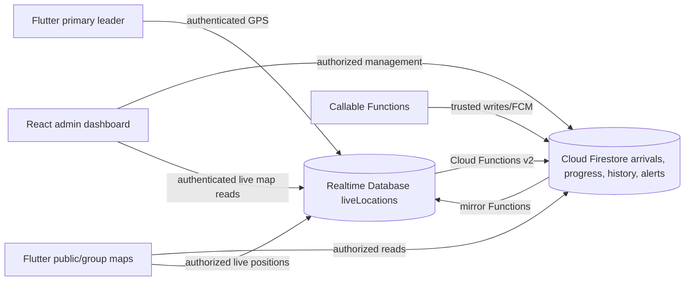

# Temple Procession Tracker

Temple Procession Tracker is a GPS-assisted event and group coordination system for temple processions. It combines a Flutter mobile app for Android (iOS is a future target), a React/Vite administrator dashboard, and Firebase backend services.

**Development status:** Phase 31 source has been implemented but remains pending end-to-end testing; later phases are proposed by the accompanying Phase 32–41 implementation guide. This README describes intended MVP features once validated. It is **not** a claim that Android field testing, Cloud Messaging, or a public MVP release has passed.

**Repository:** https://github.com/Walter926/temple-procession-tracker

## Features

- Firebase email/password authentication, registration and role-aware app navigation.
- Event, route, segment, stop point, group and leader management on the web dashboard.
- Event- and group-scoped access code redemption through trusted callable Functions.
- Foreground GPS tracking for an authenticated, assigned primary team leader.
- Public-event map (visitor-view route/stops), assigned Group Map, live markers and status indicators (subject to live-location read authorization).
- Server-derived geofence stop arrivals, confirmed progress, approximate ETA and delay flags.
- **Planned/test-pending Phases 32–38:** congestion alerts, leader acknowledgements, admin-approved route suggestions, dashboard live GPS, in-app/FCM notifications and sampled location history.
- **Planned/test-pending Phases 39–40:** MVP regression testing and 2–4 phone field testing.

Only features that pass the project test checklist should be represented as released in a GitHub Release.

## Technology stack

| Layer | Technology |
|---|---|
| Mobile | Flutter, Dart, `go_router`, Google Maps Flutter, Geolocator |
| Admin web | React 19, TypeScript, Vite 8, React Router, `@react-google-maps/api` |
| Authentication | Firebase Authentication |
| Persistent data | Cloud Firestore |
| Live GPS / mirrors | Firebase Realtime Database |
| Backend | Firebase Cloud Functions v2, Node.js 24, TypeScript, Firebase Admin SDK |
| Notifications | Firebase Cloud Messaging (Android support planned/test-pending) |
| Files | Firebase Storage |
| Maps | Google Maps SDK for Android and Google Maps JavaScript API |

## Architecture overview



**Security model:** Firestore and RTDB rules reject direct writes to server-owned alert, arrival, history and notification records. Callable Functions derive the acting user from Firebase Auth. The primary leader's GPS write requires matching `trackingAssignments/{groupId}` and an active `eventStates/{eventId}`. Phase 26's authenticated event-level live map read is intentionally broader than per-group location privacy; reassess before opening a public anonymous tracking URL.

**Key paths:** Firestore `events`, `publicEvents`, `groups`, `routes`, `stopPoints`, `groupProgress`, `stopArrivals`; RTDB `liveLocations/{eventId}/{groupId}`, `trackingStatus/{eventId}/{groupId}`, `trackingAssignments/{groupId}`, `eventStates/{eventId}`. Later phases add Firestore `collisionAlerts`, `notifications`, `routeSuggestions`, `locationHistory` and RTDB `activeCollisionAlerts`.

## Repository structure

```text
temple-procession-tracker/
├─ admin_dashboard/            # React/Vite dashboard
│  ├─ src/components/          # MapCanvas, layout, role guard
│  ├─ src/lib/                 # Firebase initialization, records, mutations
│  ├─ src/pages/               # Events, Groups, Maps, Alerts, Notifications
│  └─ .env.example             # Web environment variable names
├─ functions/                  # Node.js 24 Firebase Functions v2
│  └─ src/                     # Access codes, mirrors, arrivals, progress, new triggers
├─ firebase_rules/             # Firestore, RTDB, Storage rules and indexes
├─ mobile_app/
│  └─ temple_procession_tracker_app/
│     ├─ lib/app/             # go_router paths and access guards
│     ├─ lib/core/            # Models, repositories, GPS/status services
│     ├─ lib/features/        # Screens: auth, map, tracking, notifications
│     ├─ android/             # Android build and manifest
│     └─ ios/                 # Future iOS builds
├─ firebase.json               # Firebase deployment mapping
├─ .firebaserc                 # Firebase project alias
├─ LICENSE                     # MIT
└─ README.md
```

## Local setup (Windows 11 / PowerShell)

Install **Git**, a supported **Node.js 24** runtime for Cloud Functions, **Firebase CLI**, **Flutter SDK**, Android Studio/Android SDK and a Google Play-enabled Android emulator. Node.js 24 is the declared Functions runtime; the admin dashboard may use a compatible Node.js version supported by Vite 8.

```powershell
# In PowerShell, use an existing checkout or clone the repository
git clone https://github.com/Walter926/temple-procession-tracker.git
cd temple-procession-tracker
npm --prefix functions ci
npm --prefix admin_dashboard ci
cd mobile_app\temple_procession_tracker_app
flutter doctor
flutter pub get
cd ..\..
```

Use VS Code to create `admin_dashboard/.env.local` by copying variable **names** from `admin_dashboard/.env.example`; fill in keys from your own Firebase web app and a restricted browser Maps key. **Never commit `.env.local`, private service-account JSON, FCM tokens or Android signing material.** Use `git status --short` to verify exclusions. Production deployments also require billing/project permissions and appropriate API configuration.

## Firebase configuration and deployment

1. Create/select an authorized Firebase project. The guide's development project is `temple-procession-walter`; do not accidentally deploy to someone else's project.
2. Enable the Authentication provider(s) used by the app, Cloud Firestore, Realtime Database and (if needed) Storage/FCM. Choose/confirm actual regions in Firebase Console.
3. Configure a Firebase **Web App** for the admin dashboard, Android app registration, and FlutterFire-generated `firebase_options.dart` for your own application. Your Android app also needs valid Firebase Android configuration and package registration.
4. Copy the exact Realtime Database URL into the callable Functions `RTDB_URL` parameter when prompted. For the referenced project: `https://temple-procession-walter-default-rtdb.firebaseio.com` (verify in Console before use).
5. Set `VITE_FIREBASE_DATABASE_URL` in `admin_dashboard/.env.local` to that same database URL.
6. Reconcile `firebase_rules/firestore.rules`, `firebase_rules/database.rules.json`, `firebase_rules/firestore.indexes.json` against deployed behavior. Test rules with the Firebase Emulator Suite and a disposable project before deployment.

```powershell
firebase login
firebase use
npm --prefix functions run lint
npm --prefix functions run build
firebase functions:list
# After positive + negative security tests and project confirmation:
firebase deploy --only "functions"
firebase deploy --only "firestore:rules,firestore:indexes,database"
```

**Deployment order:** Functions first, verify expected event/group mirrors and data in RTDB, then deploy security rules. Never relax a rule to “make the demo work.” After changing statuses, check `trackingAssignments`, `eventStates`, and `groupStatuses` mirror paths. The SDK and Flutter app must target the same Firebase project.

## Google Maps API setup

Enable the **Maps SDK for Android** for the Flutter app and **Maps JavaScript API** for the React dashboard in your Google Cloud project. Create **separate restricted keys**:

- **Android Maps key:** restrict by Android package name and app signing SHA-1; follow the existing Android `MAPS_API_KEY` Gradle/manifest substitution in the checked-in project. Do not copy a browser-only key into Android.
- **Browser Maps key:** restrict by approved HTTP referrers such as `http://localhost:5173/*` and your deployed dashboard origin. Set `VITE_GOOGLE_MAPS_BROWSER_KEY` in `admin_dashboard/.env.local`.

Confirm billing/API availability and use a disposable test event. A blank tile map usually indicates key restriction, billing, package/SHA-1 or API enablement problems; it is not a GPS or Firestore rule error.

## Android development and build

```powershell
cd C:\Users\johou\Downloads\temple-procession-tracker\mobile_app\temple_procession_tracker_app
flutter doctor -v
flutter pub get
flutter analyze
flutter devices
flutter run -d emulator-5554
# Release APK only after full MVP tests, Maps key and signing checks:
flutter build apk --release
```

Android 13+ needs notification permission for FCM. Foreground location must be enabled before tracking. Use the emulator's extended controls to simulate a location/route, or use independent phones for Phase 40 collision field tests. The `android/app/src/main/AndroidManifest.xml` includes permission declarations and a Maps API-key substitution; follow the project's Gradle configuration rather than hard-coding a key. Do not claim release quality from `flutter analyze` alone.

## Future iOS setup (not yet validated)

The repository contains an `ios/` Flutter project, but an iOS release needs **macOS**, Xcode, CocoaPods, Apple Developer signing and an iOS app registration in Firebase. Configure the Apple platform's Google Maps key, platform permission descriptions, background mode strategy (if eventually added), APNs/FCM integration and iOS privacy disclosures. Run `flutter doctor -v`, `pod install` where appropriate and device/simulator builds on a Mac. **The Android emulator tests in this project do not verify iOS behavior.**

## Screenshots (capture and add before releasing)

Capture real application screenshots from a **disposable test event** and remove names, phone numbers, access codes, precise private home locations and auth identifiers. Save verified images in `docs/screenshots/`:

- `admin-live-map.png` — administrator full route and live groups.
- `collision-alerts.png` — admin alert panel showing a simulated crowding event.
- `team-leader-tracking.png` — tracking state and group status.
- `group-map-progress.png` — Group Map and Phase 31 progress/ETA.
- `notifications.png` — an anonymized in-app notification.

After these **real PNG files** are added, enable image links in README, for example ``. The uploaded ZIP includes no such test screenshots, so **none are claimed to exist now**.

## Demo video

**Not recorded yet.** Record a real end-to-end demo only after the Phase 39/40 tests: admin creates a test event, two distinct leaders transmit, group markers move, a stop arrival appears, a crowding alert is acknowledged, and an admin-approved route suggestion reaches the intended leader. Upload the video to your chosen hosting service and insert its **verified public URL here**. Do not add a placeholder link that pretends to be a working video.

## Known limitations and safety notes

- The currently implemented Flutter GPS design is **foreground-only**; it does not promise dependable background location while the screen is off or the app is terminated.
- Android simulator positions do not establish battery, radio, accuracy or real multi-device reliability.
- Last known positions may become stale; interpret them as **old** rather than current. Phase 28's stale threshold is approximately 60 seconds.
- Automatic geofence arrival requires multiple valid, accurate samples and dwell; wide GPS uncertainty or stationary update throttling can delay confirmation.
- Collision alerts represent GPS-derived crowding at configured stop geofences, **not** real-time human safety guarantees, emergency dispatch or authoritative occupancy counts.
- Suggestions are advisory and must receive admin approval; alternate route and optional-stop changes should not be executed automatically.
- No unauthenticated public live-location feed or public deep link is claimed; authenticated location reading exposes the event's group locations under the guide's current rules.
- FCM delivery is best-effort, depends on Play Services/network/device permissions and must not be the sole channel for urgent instructions.
- No release readiness claim until Phase 31 and later phases pass security, regression and physical field tests. iOS remains future work.

## Roadmap

1. **Phase 31 verification gate:** complete geofence, progress, ETA and security regression checks.
2. **Phases 32–34:** implement server-owned collision detection and acknowledgement, admin-approved route suggestions.
3. **Phases 35–38:** complete dashboard maps/management, notification delivery, location history and retention/privacy review.
4. **Phase 39:** automated/unit rules and end-to-end MVP regression tests, fix release blockers.
5. **Phase 40:** 2–4 phone Android route/crowding, network, battery and stale-location field tests.
6. **Phase 41:** documentation, clean screenshots/demo and GitHub MVP release after gates pass.
7. **Future:** iOS onboarding, stronger access-scoped live reads, optional background tracking with explicit consent and battery safeguards, event data retention tools and accessibility improvements.

## License

Licensed under the [MIT License](LICENSE). Copyright information and exact license terms are in the existing root `LICENSE` file. Do not alter that file without the project owner's approval.
